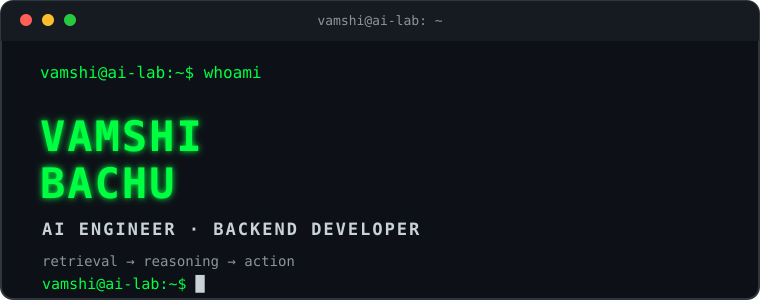

<!-- Terminal-inspired GitHub profile | Vamshi Bachu -->

<div align="center">



<a href="https://github.com/Vamshi9415">
  
</a>

</div>

---

### `vamshi@ai-lab:~$ whoami`

**Vamshi Bachu** — AI engineer and backend developer interested in building practical LLM-powered systems. I work on retrieval pipelines, agentic workflows, MCP servers, and reliable backend applications.

### `vamshi@ai-lab:~$ ls ~/projects`

| Project | Description |
|:--|:--|
| [docrag-mcp](https://github.com/Vamshi9415/docrag-mcp) | Document retrieval server with MCP, FAISS, embeddings and reranking. |
| [guarded-ai-agent-mcp](https://github.com/Vamshi9415/guarded-ai-agent-mcp) | AI agent with tool policies, guardrails and human approval. |
| [Ad-Forge](https://github.com/Vamshi9415/Ad-Forge) | Generative advertising pipeline from brief to media assets. |
| [EnseSmells](https://github.com/Vamshi9415/EnseSmells_with_explanability_Ai) | Explainable multimodal ensemble for code-smell detection. |
| [git-like-pdf-diff](https://github.com/Vamshi9415/git-like-pdf-diff) | Git-inspired PDF comparison. |
| [OCR-MARKSHEET](https://github.com/Vamshi9415/OCR-MARKSHEET) | OCR-based marksheet data extraction. |

### `vamshi@ai-lab:~$ cat stack.txt`

```text
LANGUAGES      Python · Java · SQL
BACKEND        FastAPI · REST APIs
AI / ML        LLMs · RAG · LangChain · LangGraph · PyTorch
AGENT SYSTEMS  MCP · Tool calling · Guardrails
RETRIEVAL      FAISS · Sentence Transformers · Reranking
INFRA          Docker · AWS · Linux · Git
```

### `vamshi@ai-lab:~$ cat focus.txt`

- Building reliable agentic workflows
- Improving document processing and retrieval quality
- Designing production-ready backend services

### `vamshi@ai-lab:~$ git status`

```text
Learning      [####################] ongoing
Building      [####################] ongoing
Shipping      [####################] ongoing
```

<div align="center">

<a href="https://github.com/Vamshi9415">
  
</a>

<br/><sub>Stay curious. Build things. Understand how they work.</sub>

</div>
