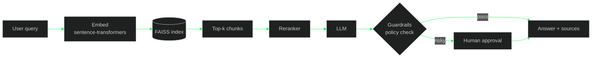

<div align="center">

```
██╗   ██╗ █████╗ ███╗   ███╗███████╗██╗  ██╗██╗
██║   ██║██╔══██╗████╗ ████║██╔════╝██║  ██║██║
██║   ██║███████║██╔████╔██║███████╗███████║██║
╚██╗ ██╔╝██╔══██║██║╚██╔╝██║╚════██║██╔══██║██║
 ╚████╔╝ ██║  ██║██║ ╚═╝ ██║███████║██║  ██║██║
  ╚═══╝  ╚═╝  ╚═╝╚═╝     ╚═╝╚══════╝╚═╝  ╚═╝╚═╝

██████╗  █████╗  ██████╗██╗  ██╗██╗   ██╗
██╔══██╗██╔══██╗██╔════╝██║  ██║██║   ██║
██████╔╝███████║██║     ███████║██║   ██║
██╔══██╗██╔══██║██║     ██╔══██║██║   ██║
██████╔╝██║  ██║╚██████╗██║  ██║╚██████╔╝
╚═════╝ ╚═╝  ╚═╝ ╚═════╝╚═╝  ╚═╝ ╚═════╝
```

<a href="https://github.com/Vamshi9415">
  
</a>

</div>

---

```bash
vamshi@ai-lab:~$ cat profile.py
```

```python
from dataclasses import dataclass, field

@dataclass
class AIEngineer:
    name: str = "Vamshi Bachu"
    roles: tuple = ("AI Engineer", "Backend Developer")
    languages: list = field(default_factory=lambda: ["Python", "Java", "SQL"])
    builds: list = field(default_factory=lambda: [
        "RAG pipelines", "agentic workflows", "MCP servers", "production backends",
    ])
    principles: list = field(default_factory=lambda: [
        "ship beyond the demo",
        "guardrails by default",
        "retrieval quality before model size",
        "if you can't explain it, you don't own it",
    ])

    def run(self):
        while True:
            self.learn(); self.build(); self.ship()

if __name__ == "__main__":
    AIEngineer().run()
```

---

```bash
vamshi@ai-lab:~$ ls -la ~/projects
```

| 📁 repo | description | stack |
|:--|:--|:--|
| [`docrag-mcp`](https://github.com/Vamshi9415/docrag-mcp) | Document retrieval server over MCP with embeddings, FAISS and reranking | `RAG` `MCP` `FAISS` |
| [`guarded-ai-agent-mcp`](https://github.com/Vamshi9415/guarded-ai-agent-mcp) | Tool-using agent with policy checks, guardrails and human approval flows | `Agents` `MCP` `Guardrails` |
| [`Ad-Forge`](https://github.com/Vamshi9415/Ad-Forge) | Generative ad pipeline: briefs → storyboards → media assets | `GenAI` `Pipelines` |
| [`EnseSmells`](https://github.com/Vamshi9415/EnseSmells_with_explanability_Ai) | Explainable multimodal ensemble for code-smell detection | `ML` `XAI` |
| [`git-like-pdf-diff`](https://github.com/Vamshi9415/git-like-pdf-diff) | Git-style diffing for PDF documents | `Python` `Docs` |
| [`OCR-MARKSHEET`](https://github.com/Vamshi9415/OCR-MARKSHEET) | OCR-based marksheet data extraction | `OCR` `Python` |

---

```bash
vamshi@ai-lab:~$ cat architecture/rag_pipeline.mmd
```



---

```bash
vamshi@ai-lab:~$ python run_agent.py --task "summarize contract and email legal" --verbose
```

```text
[plan]     1. retrieve_docs  2. summarize  3. send_email
[tool]     retrieve_docs(query="contract") -> 6 chunks (reranked)
[llm]      summarize(context=6 chunks) -> 142 tokens
[policy]   send_email -> external recipient -> REQUIRES_APPROVAL
[human]    approve send_email to legal@example.com? [y/N] y
[tool]     send_email(to="legal@example.com") -> ok
[done]     3 steps | 1 approval | 0 policy violations
```

<sub>↑ illustrative trace of the guarded-agent pattern</sub>

---

```bash
vamshi@ai-lab:~$ cat mcp.config.jsonc
```

```jsonc
{
  "mcpServers": {
    "docrag":        { "role": "retrieval over private documents" },
    "guarded-agent": { "role": "tool calling with policy + approval" }
  },
  "principles": ["least privilege", "human in the loop for risky actions", "log everything"]
}
```

---

```bash
vamshi@ai-lab:~$ pip freeze | grep -i "ai-stack"
```

```text
fastapi
langchain
langgraph
torch
sentence-transformers
faiss-cpu
docker
```

<p>
  
</p>

```text
Languages      : Python, Java, SQL
Backend        : FastAPI, REST APIs
AI / ML        : LLMs, RAG, LangChain, LangGraph, PyTorch
Agent Systems  : MCP, tool calling, guardrails
Retrieval      : FAISS, sentence-transformers, reranking
Infrastructure : Docker, AWS, Linux, Git
```

---

```bash
vamshi@ai-lab:~$ git log --stat --author="vamshi"
```

<p align="center">
  
  
</p>

---

```bash
vamshi@ai-lab:~$ cat experiments.todo
```

- [x] RAG with embeddings, FAISS and reranking
- [x] Agents with guardrails and human approval
- [ ] Reliable multi-step agentic workflows
- [ ] Better document processing and retrieval quality
- [ ] Production-ready backend services for LLM apps

---

```bash
vamshi@ai-lab:~$ ./connect.sh
```

<p>
  <a href="https://github.com/Vamshi9415"></a>
  <!-- Add yours:
  <a href="https://linkedin.com/in/YOUR_ID"></a>
  <a href="mailto:YOUR_EMAIL"></a>
  -->
</p>

```bash
vamshi@ai-lab:~$ echo "Stay curious. Build things. Understand how they work."
Stay curious. Build things. Understand how they work.
vamshi@ai-lab:~$ █
```
